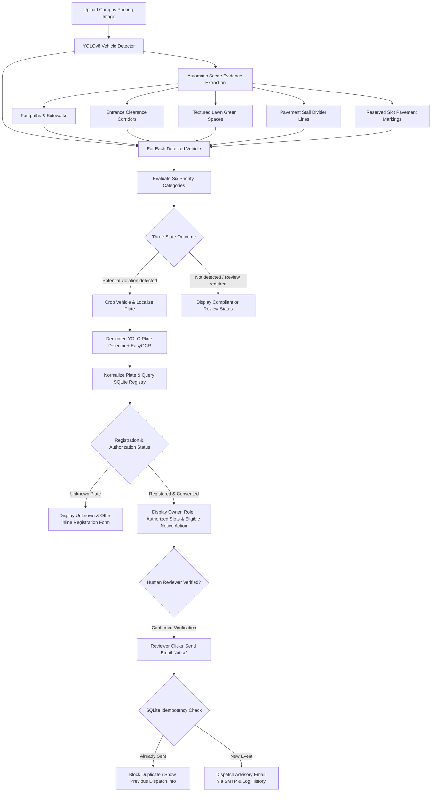

# Smart Parking — Six Priority College Campus Violations

> **Deep Learning & Computer Vision Lab Academic Mini-Project**  
> An academic computer vision prototype that detects vehicles in campus parking scenes, proposes outcomes for **Six Priority Campus Parking Violation Categories**, extracts vehicle number plates via OCR, checks a SQLite registry, and supports reviewer-confirmed email notifications.

---

## 1. Project Overview & Features

College campuses require automated parking monitoring to prevent fire exit blockages, protect pedestrian walkways, preserve landscaped lawns, and manage reserved faculty and emergency bays.

This upgraded system provides:
1. **Automated prototype analysis:** The vision pipeline proposes scene features and violation outcomes without manual polygon drawing. Reviewers must verify each result; performance depends on camera angle, lighting, and visible markings.
2. **Six Priority Violation Categories:**
   - **Category 1: Unauthorized parking / no-parking zones** (red curbs, fire hydrants, marked restricted zones; distinguishes vehicles legally passing signs from actual violations).
   - **Category 2: Footpath parking** (cars and motorcycles parked on pedestrian sidewalks and walkways).
   - **Category 3: Blocking entrances and emergency access** (vehicles obstructing college gates, building doors, and yellow-hatched clearance corridors).
   - **Category 4: Parking on green spaces** (strong agreement at both estimated tire-contact areas can trigger a potential violation; ambiguous surface evidence is sent for human review).
   - **Category 5: Improper parking alignment** (vehicles straddling painted stall divider lines or occupying multiple spaces, filtering car contours).
   - **Category 6: Wrong parking slot** (vehicles occupying reserved faculty, staff, visitor, or principal slots without matching database authorization).
3. **Transparent Three-State Classification Standard:**
   - **`Potential violation detected`**: Strong visual and spatial evidence confirms the violation.
   - **`Not detected`**: Evidence confirms compliant parking.
   - **`Review required`**: Ambiguous boundaries, faded markings, uncalibrated angles, or low OCR confidence honestly reported for human review.
4. **Number-Plate Recognition (ALPR):** Localizes license plates using a dedicated YOLO model (`models/license_plate_detector.pt`) and extracts characters using **EasyOCR** with alphanumeric normalization.
5. **Role-Based Authorization & Registration (SQLite):**
   - Stores vehicle plate, owner name, email, notification consent, campus role (`faculty`, `staff`, `principal`, `student`, `visitor`, `vendor`), and authorized slots.
   - Synchronized `parking_permissions` table for permit IDs and validity dates.
   - Pre-seeded with realistic campus test profiles.
6. **Optional Inline Registration for Unknown Vehicles:**
   - If an unknown vehicle is detected in a potential violation, reviewers can optionally register the vehicle inline (plate, owner, role, email, consent).
   - Registration **never** triggers an automatic email.
7. **Human-in-the-Loop Review & Manual Email Notifications:**
   - **NEVER** sends automated emails upon image upload or analysis.
   - Reviewer explicitly verifies the annotated image, number plate, category, and recipient.
   - Verified recipient must have explicit notification consent (`consent_status = 1`).
   - SQLite idempotency check (`notification_history`) prevents duplicate notifications for the same event.
8. **Academic Jupyter Notebook (`parking_violation_detection.ipynb`):**
   - Step-by-step pipeline demonstration, visualization, and quantitative evaluation (Precision, Recall, F1-Score) on ground-truth benchmark labels.

---

## 2. Priority Violation Categories Implementation Status

| Category | Primary CV / DL Technique | Classification Evidence | Implementation Status |
| :--- | :--- | :--- | :--- |
| **1. Unauthorized No-Parking Zone** | HSV red curb segmentation, fire hydrant detection, signage reasoning | Tire ground-contact overlap with red curb / hydrant buffer | **Prototype heuristic; scene dependent** |
| **2. Footpath Parking** | Sidewalk pavement segmentation & curb edge filtering | Tire ground-contact overlap on pedestrian walkway | **Prototype heuristic; scene dependent** |
| **3. Blocking Entrances & Emergency Access** | Yellow clearance hatching plus Cityscapes building-façade overlap fallback | Marked-zone overlap can flag a potential violation; unmarked façade overlap returns **Review required** | **Prototype heuristic; scene dependent** |
| **4. Parking on Green Spaces** | HSV green masking + Laplacian texture variance ($> 40.0$) | Tire patch vegetative density ($> 35\%$) and micro-texture | **Prototype heuristic; scene dependent** |
| **5. Improper Parking Alignment** | Pavement Canny edge + HoughLinesP, car interior edge filtering | Stall divider line passing through vehicle interior body | **Prototype heuristic; scene dependent** |
| **6. Wrong Parking Slot** | EasyOCR pavement keyword detection + SQLite authorization query | Plate role/permit check against slot type (`faculty`, `principal`, etc.) | **Prototype heuristic; scene dependent** |

---

## 3. System Architecture & Workflow



---

## 4. Directory Structure

```text
DL Project/
├── app.py                             # Clean Streamlit UI with 6-category breakdown
├── campus_violation_engine.py         # Modular computer vision engine for all 6 categories
├── config.py                          # Thresholds, class mappings, category definitions, SMTP
├── database.py                        # SQLite schema (registry, permissions, history, audit)
├── registry.py                        # Vehicle database CRUD, normalization, and validation
├── parking_detector.py                # Pipeline orchestrator and visualization renderer
├── plate_reader.py                    # Dedicated YOLO plate detection & EasyOCR pipeline
├── notifications.py                   # SMTP dispatch, idempotency check, and SQLite audit logging
├── parking_violation_detection.ipynb  # Academic Jupyter notebook with full lab experiment
├── generate_notebook.py               # Generator script for notebook cells and evaluation
├── requirements.txt                   # Pinned dependency requirements
├── .env.example                       # Environment variable template with placeholders
├── README.md                          # Project documentation and viva guide
├── data/
│   ├── parking_system.db              # SQLite database (auto-seeded on startup)
│   ├── seed_vehicles.json             # Seed configuration for registered vehicles
│   └── test_images/                   # Benchmark test images for all 6 categories
│       ├── scene_clearly_marked_restricted_area.png
│       ├── scene_near_no_parking_sign.png
│       ├── scene_cat2_footpath_parking.png
│       ├── scene_cat2_footpath_compliant.png
│       ├── scene_cat3_blocking_entrance.png
│       ├── scene_cat3_entrance_clear.png
│       ├── scene_cat4_lawn_parking.png
│       ├── scene_cat4_paved_parking.png
│       ├── scene_cat5_improper_alignment.png
│       ├── scene_cat5_proper_alignment.png
│       ├── scene_cat6_wrong_slot_unauthorized.png
│       ├── scene_cat6_correct_slot_authorized.png
│       └── scene_unreadable_blurry_plate.png
├── models/
│   ├── yolov8n.pt                     # Pretrained YOLOv8 vehicle detector (Ground / Eye-Level COCO)
│   ├── yolov8n_visdrone.pt            # Pretrained YOLOv8 aerial/overhead vehicle detector (VisDrone)
│   └── license_plate_detector.pt      # Pretrained YOLO license plate detector
└── tests/
    ├── test_campus_violations.py      # 29 tests for all 6 categories & edge cases
    ├── test_parking_pipeline.py       # 24 detection, OCR, and pipeline tests
    ├── test_optional_registration_workflow.py # 12 inline registration tests
    └── test_registered_vehicles_notifications.py # 10 registry, consent & SMTP tests
```

---

## 5. Setup and Running on Windows (PowerShell)

### Step 1: Open PowerShell and Navigate to Project Directory
```powershell
cd "d:\DL Project"
```

### Step 2: Activate Python Virtual Environment
```powershell
.\venv\Scripts\Activate.ps1
```

### Step 3: Configure Environment Variables (.env)
Copy `.env.example` to create your local `.env` file:
```powershell
Copy-Item .env.example .env
```
Open `.env` and configure your credentials:
* `APP_PASSWORD`: Security access key for the web portal.
* `SMTP_EMAIL` and `SMTP_APP_PASSWORD`: (Optional) Gmail SMTP credentials for verified email notifications.
* `CONFIGURED_LOCATION`: Facility name shown in notification emails.

> [!IMPORTANT]
> The `.env` file contains sensitive credentials and is strictly excluded from version control by `.gitignore`. Never commit real passwords or API keys to the repository.

### Step 4: Install Required Dependencies
```powershell
pip install -r requirements.txt
```

### Step 4: Verify Pretrained Models
Ensure weights exist in `models/`:
- `models/yolov8n.pt`: Standard COCO model for street-level / eye-level campus parking views.
- `models/yolov8n_visdrone.pt`: High-performance overhead / aerial vehicle detector for top-down parking lots.
- `models/license_plate_detector.pt`: License plate localization model.

Footpath segmentation uses NVIDIA's SegFormer checkpoint already fine-tuned on Cityscapes by default. An optional local BDD100K fine-tuned checkpoint is loaded automatically from `models/bdd100k_sidewalk_segformer/` when present. The `transformers` dependency is included in `requirements.txt`; the first run needs internet access to cache the base checkpoint. If loading fails, the app warns and falls back to visual heuristics.

For parking-space research, MetaPKLot supplies COCO-style parking-space polygons, occupancy labels, and vehicle masks. Its source datasets have different licenses, and its recommended evaluation holds out a source dataset to measure cross-camera generalization. Cityscapes provides sidewalk semantic labels and is available under its scientific-purpose terms after registration. These datasets address separate model tasks and should be evaluated separately.

#### MetaPKLot parking-space fine-tuning

The repository includes `scripts/prepare_metapklot.py` to convert the original spot polygons into YOLO segmentation labels (classes: `empty`, `occupied`). It keeps PKLot images in training and CNRPark-EXT images in validation to provide a source-held-out check. Prepare all available frames and fine-tune the segmentation model with:

```powershell
python scripts/prepare_metapklot.py
python scripts/train_metapklot.py --epochs 30 --device 0
```

Use `--device cpu` when CUDA is unavailable. For a quick pilot, pass `--max-images-per-source 40` to the preparation script, followed by `python scripts/train_metapklot.py --epochs 5 --imgsz 416 --batch 2 --device cpu --name pilot_5epochs`. The current pilot used 120 PKLot training images and 360 CNRPark-EXT validation images. Its best held-out mask mAP@0.5 was 0.228 (mAP@0.5:0.95 was 0.0641), so it is an experimental checkpoint and should not replace the app's vehicle detector. The weights are saved locally at `models/metapklot_parking_spaces.pt`; plots and metrics are under `training_runs/metapklot/pilot_5epochs/`.

The base footpath segmenter is the Cityscapes-finetuned NVIDIA SegFormer checkpoint. The optional BDD100K path below adds broader street-scene variety, including a dedicated sidewalk class, without replacing the existing checkpoint unless sidewalk IoU improves on BDD100K's held-out validation split. Public street imagery cannot guarantee accuracy on every campus driveway, private path, or camera angle; retain a separate campus-camera holdout for that check.

#### General footpath / sidewalk adaptation with BDD100K

BDD100K has 10,000 labeled semantic-segmentation images and a dedicated sidewalk label whose class IDs match the model already used by the app. The official host can be unavailable on some networks, so `scripts/download_bdd100k_subset.py` fetches a bounded subset from a Hugging Face mirror that identifies itself as an unmodified redistribution of the official files. The downloader preserves the dataset's license notice and uses a deterministic selection seed. BDD100K terms limit ordinary use to educational, research, and not-for-profit purposes; commercial rights require separate authorization. The downloader fetches at most 1,500 training and 300 validation pairs by default rather than the full 10K set. The trainer then fine-tunes the segmentation head on a deterministic 500-image subset by default to keep CPU runs practical; its full prepared validation split is never used for gradient updates. The official [download documentation](https://github.com/bdd100k/bdd100k/blob/master/doc/source/download.rst) describes the source packages.

```powershell
python scripts/download_bdd100k_subset.py
python scripts/prepare_bdd100k_semantic.py
python scripts/train_bdd100k_sidewalk.py --epochs 3 --device cpu
```

Use `--device 0` when CUDA is available. The trainer compares the base checkpoint and each fine-tuned epoch on the same held-out BDD100K validation images, selects by sidewalk IoU, and saves `models/bdd100k_sidewalk_segformer/` only if sidewalk IoU improves over the base. The app then uses that local checkpoint on its next restart. The training summary records the comparison. Check it against a separate campus-image holdout before relying on predictions; if the checkpoint does not improve on campus imagery, remove/rename the local checkpoint to return to the original Cityscapes model.

Footpath and grass checks use small patches under the estimated left and right tire contacts rather than broad overlap with the full vehicle box. Where the Cityscapes model is available, its road/sidewalk predictions are compared with the OFFSED grass prediction: confident road or sidewalk evidence at both contacts prevents nearby greenery or a coarse sidewalk polygon from being treated as a grass/footpath result. Strong grass evidence at both tire contacts can produce a **Potential violation detected** result; ambiguous overlap remains **Review required** because overlap alone does not prove illegal parking. The model dependencies must be installed for semantic predictions; without `transformers`, the app falls back to image heuristics, which are less reliable.

#### OFFSED grass and pavement adaptation

OFFSED provides semantic masks for 203 frames. The preparation script downloads only images paired with those masks from the official OPEDD archive (it does not download the other unlabeled images or the full 3.8 GB archive). It reads the actual RGB mask palette from OFFSED's `labelmap.txt` and maps drivable pavement to `road`, non-drivable pavement to `sidewalk_proxy`, and grass to `grass`; all other classes are ignored. Because OFFSED is an off-road dataset, `sidewalk_proxy` is not treated as a true campus footpath label.

```powershell
python scripts/prepare_offsed.py
python scripts/train_offsed_surface.py --epochs 3 --device cpu
python scripts/evaluate_offsed_surface.py
```

Training starts from the app's Cityscapes-finetuned SegFormer and saves the local adapted weights under `models/offsed_surface_segformer/`. The app uses this optional model to identify likely grass regions and assess the vehicle ground-contact patch. Strong two-contact grass evidence can produce a potential violation; uncertain surface evidence returns `Review required`. Without the local checkpoint, existing color/texture heuristics remain available and ambiguous green evidence requests review.

The source page does not state a dataset license. Keep the required publication citation and check with the dataset authors before redistributing the data or using it commercially: [OFFSED paper and dataset page](https://www.dfki.uni-kl.de/~neigel/offsed.html). The Mendeley unauthorized-parking record advertises 443 images under CC BY-NC 4.0, but its public file listing is empty and archive download is forbidden, so this project does not include or train on it. The Walkway Segmentation dataset is not included per the user's instruction to proceed with OFFSED alone.

### Human prediction feedback

Each category in a vehicle's assessment includes **Correct** and **Wrong** feedback. A wrong vote asks for the corrected category. Feedback is stored in the local SQLite database with the source image, vehicle box, prediction evidence, and detector name; the source image is written under `data/feedback_images/` only after a vote is submitted. This is local review data and is ignored by Git. Votes do not change model weights immediately.

Export the collected reviews for curation with:

```powershell
python scripts/export_prediction_feedback.py
```

The export writes `data/training/prediction_feedback/manifest.jsonl` and its referenced images. It is a category-level feedback set, not a ready-made segmentation dataset. Fine-tuning the grass segmenter still requires reviewed pixel masks, and any model update should be validated on separate images before it replaces the current checkpoint.

`scripts/evaluate_offsed_surface.py` evaluates only the held-out split, records grass-mask overlap with detections from the existing `yolov8n.pt` vehicle detector, and writes a visualization to `training_runs/offsed_surface/evaluation/heldout_segmentation_and_overlap.png`. Vehicle-overlap values are model predictions, not ground-truth violation labels; use them for qualitative review only.

The current local run used all 203 labeled frames (162 train / 41 validation), with a deterministic split. Validation IoU was 0.997 for grass, 0.958 for the non-drivable-pavement proxy, and 0.000 for drivable pavement (mean IoU 0.652). Drivable pavement was very rare in the held-out labels, so this checkpoint is intended only as an experimental grass-region signal; it is not a general road/sidewalk segmenter. The existing vehicle detector returned two candidate cars on the held-out split; both had predicted grass overlap and are marked `Review required`. These are qualitative predictions, not verified violation cases. The UI should be checked against local campus camera images before operational use.

### Step 5: Configure App Access and Optional SMTP Notices
Copy `.env.example` to `.env`:
```powershell
Copy-Item .env.example .env
```
Populate `.env` with your credentials:
```ini
APP_PASSWORD=use_a_unique_random_password_at_least_16_characters
SMTP_EMAIL=your_email@gmail.com
SMTP_APP_PASSWORD=your_16_digit_app_password
SMTP_SERVER=smtp.gmail.com
SMTP_PORT=587
SMTP_USE_TLS=true
CONFIGURED_LOCATION=Main Campus Parking Area
```
The app will not expose the registry or controls until `APP_PASSWORD` is configured with at least 8 characters. Keep `.env` private. The shared password, local SQLite database, and single-process Streamlit setup are for a trusted demo only; they are not suitable for public or multi-user production deployment. The app expires idle sessions after `AUTH_IDLE_TIMEOUT_MINUTES` (default 30) and provides a sign-out button, but production hosting still needs HTTPS, individual accounts/roles, secret management, backups, and operational monitoring. If SMTP credentials are unset, email dispatch stays unavailable; analysis and review remain usable. Uploads are limited to 15 MB and 40 million pixels by default. Keep `MAX_IMAGE_UPLOAD_MB` aligned with `.streamlit/config.toml`.

Optional model and database paths can be overridden with `VEHICLE_MODEL_PATH`, `OVERHEAD_VEHICLE_MODEL_PATH`, `PLATE_MODEL_PATH`, `OFFSED_SURFACE_MODEL_PATH`, `BDD100K_SIDEWALK_MODEL_PATH`, and `DB_PATH`. Relative values are resolved from the project directory; absolute paths are also accepted. Keep the SQLite database on persistent local storage and back it up consistently with its WAL files.

### Streamlit Community Cloud model files

The deployed app must receive the model files through Git; files present only on the development computer are not available to Streamlit Cloud. This repository keeps the license-plate detector (`models/license_plate_detector.pt`) and the OFFSED grass model (`models/offsed_surface_segformer/`) eligible for tracking while continuing to ignore datasets, training runs, and unrelated weights. Include those model files in the commit sent to the deployment branch. Without them, plate reading falls back to OCR-only localization and grass classification uses weaker image heuristics, which can produce more `Review required` results. The plate preview labels an estimated crop when no plate can be localized; that crop is for manual verification and is not treated as a recognized plate.

---

## 6. Running the Streamlit Application

### React Bits interface animations

The UI uses small original Streamlit Components v2 effects inspired by React Bits **Blur Text** and **Fade Content**: a short heading entrance and a result-banner reveal after Python inference finishes. React Bits currently publishes its component source under an MIT + Commons Clause license that restricts redistribution of components in a bundle or as a port. To keep this project self-contained and suitable for submission, no React Bits source or npm dependency is copied into the repository. The Analyze action retains Streamlit's built-in spinner; all prediction, OCR, SQLite, feedback, and notification operations remain in Python. The animations respect `prefers-reduced-motion`; button hover remains CSS-only.

No new Python or npm dependencies are needed. The current pinned Streamlit version already supports Components v2. Start the application using the regular command below.

Launch the application:
```powershell
python -m streamlit run app.py
```
Open your browser at `http://localhost:8501`.

### Step-by-Step Testing Walkthrough:
1. **Select a Benchmark Test Scene:**
   - Under **Sample Scenes**, choose any of the six categories (e.g. *Category 2: Footpath Parking*, *Category 4: Green Spaces*, *Category 6: Wrong Slot*).
2. **Click Analyze Image:**
   - The application automatically analyzes the scene, evaluates all six categories, reads the license plate, and queries SQLite.
3. **Inspect the Interactive Breakdown:**
   - Expand the **View Six-Category Assessment Breakdown** on any vehicle card to see the status, explanation, and evidence for each category.
4. **Test Optional Registration (Unknown Vehicles):**
   - For an unregistered vehicle, fill the inline form (Owner, Role, Email, Notification Consent) and click **Save Registration**.
5. **Send Email Notice (Eligible Cases):**
   - For a verified violation with a consenting registered recipient, check the verification checkbox and click **Send Email Notice**.
   - Repeat clicks are safely blocked by the SQLite idempotency check.

---

## 7. Running the Deep Learning Lab Notebook

Regenerate and run the notebook:
```powershell
python generate_notebook.py
jupyter notebook parking_violation_detection.ipynb
```
The notebook executes:
1. Vehicle detection with YOLOv8 and ground-contact calculation.
2. Pavement segmentation, clearance corridors, and lawn texture analysis.
3. Automated evaluation across all six categories on benchmark test scenes.
4. License plate detection and EasyOCR character recognition.
5. Role-based SQLite authorization query.
6. Confusion matrix, Precision, Recall, and F1-score calculation:
   - Reported scores apply only to the labeled project benchmark scenes; they do not establish accuracy on new campus footage.
7. Lab Viva defense preparation notes.

---

## 8. Automated Testing

Run the full test suite across all modules with mocked SMTP:
```powershell
python -m pytest -q
```

### Current Verification
```text
75 passed; 29 dependency warnings (Python 3.11, local CPU environment)
```
Passing benchmark tests does not establish accuracy on new campus cameras or real-world enforcement settings. Validate with a separate, representative campus-image holdout before operational use. The current segmentation validation is not sufficient for production use, and no live SMTP, deployed HTTPS/identity provider, production backup/restore, or real operational camera integration has been verified.

### Submission packaging and privacy

Submit the source code, `requirements.txt`, `.env.example`, README, tests, benchmark images, and only the model weights needed for the demonstration. Do **not** include `.env`, `venv/`, `data/parking_system.db`, `data/feedback_images/`, `data/training/`, raw external datasets under `data/external/`, or `training_runs/` unless your instructor specifically requires them and redistribution is permitted. The local SQLite database and feedback images may contain vehicle plates and contact details; distribute only a clean database initialized from the sample seed records.

---

## 9. Academic Disclaimer

This project is developed solely for educational and academic evaluation within the Deep Learning Laboratory. It is an academic prototype and does not represent an official legal, traffic fine, or punitive enforcement system.
